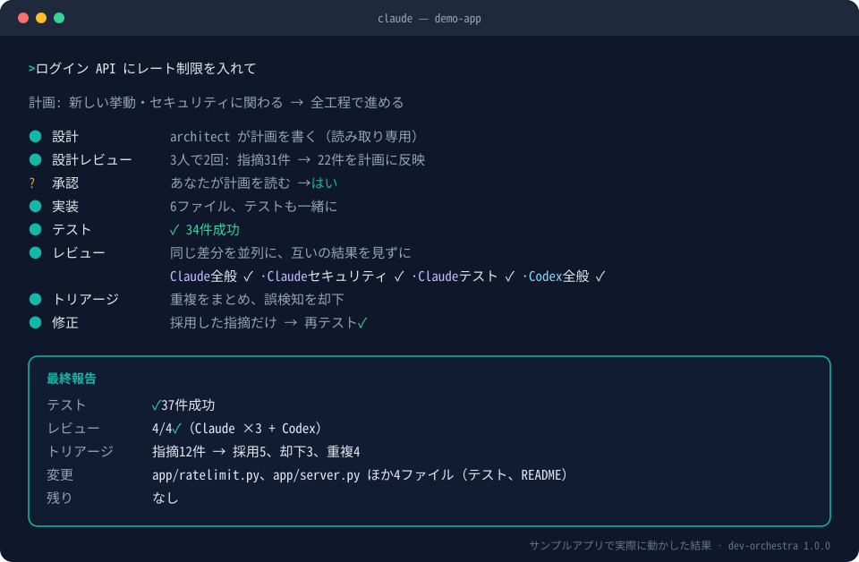
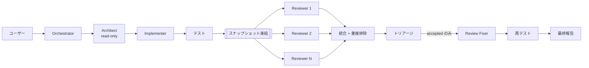

# dev-orchestra

[](https://github.com/istb16/dev-orchestra/actions/workflows/ci.yml)
[](https://github.com/istb16/dev-orchestra/releases)
[](LICENSE)

[English](README.md) | **日本語**

**AI に、自分のコードをレビューさせない。**

Claude が作り、Codex が疑い、dev-orchestra がまとめる。

- **独立したレビュー** — 別々のモデルが、互いを見ずに同じ差分を確かめる
- **API キー不要** — いまログインしている CLI をそのまま使う
- **1 文で始まる** — 「ログイン API にレート制限を入れて」

Claude Code、Codex、Antigravity で動きます。始めるだけなら Claude Code ひとつで足ります。



## すぐ試す

```bash
claude plugin marketplace add istb16/dev-orchestra
claude plugin install dev-orchestra@dev-orchestra
```

Claude Code の新しいセッションを開き、ふだんの言葉で頼みます。

> dev-orchestra で issue #12 を実装して

初回は保存するプリセット（`quality`・`standard`・`fast`）を尋ね、入っている CLI に合わせます。
typo の修正なら編集だけ、スキーマの変更なら全工程を通ります。

紹介記事: [設計・実装・複数AIレビューを1文で回す dev-orchestra を公開してみた](https://tk3.biz/blog/2026-10-13-dev-orchestra-introduction/)
（何ができるか、codex-plugin-cc との違い、Claude Code だけでも使う意味）

## なぜ

自分の成果物を見直すモデルは、バグを生んだ思い込みまで共有しています。互いの意見を知らない
別々のモデルに同じ差分を読ませると、有用な形で食い違い、その食い違いに本物のバグがあります。
指摘は重複をまとめ、トリアージしてから直すので、修正役に届くのは短いリストです。

## 仕組み

| 工程 | 設定上のロール | 役割 |
| --- | --- | --- |
| 指揮 | `orchestrator` | 依頼に必要な工程を判断し、大量の入力を消化し、結果を統合する |
| 設計 | `architect` | 調査して計画を書く（読み取り専用）。承認するまで実装には進まない |
| 実装 | `implementer` | 計画からコードとテストを書く |
| レビュー | reviewers | 2つ以上のモデルが同じ凍結済みの差分を、読み取り専用で、互いを見ずに読む |
| 修正 | `review_fixer` | オーケストレーターが accepted にした findings だけを直す |



どのロールにも、対応する CLI とモデルの family を自由に割り当てられます。構成は
`dev-orchestra config setup` で選べ、詳しくは[設定](docs/ja/references/configuration.md)にあります。

## 必要なもの

- **Python 3.11 以上**（標準ライブラリのみ）。`python3` で、または自動で選ぶ `bin/dev-orchestra[.ps1]` で実行します
- **git**
- **ログイン済みの CLI のどれか**: [Claude Code](https://claude.com/claude-code)（`claude`）、
  [Codex CLI](https://developers.openai.com/codex/cli)（`codex`）、Antigravity CLI（`agy`）。
  `agy` には読み取り専用のモードがないので、担当するのは implementer と review fixer です
  （[providers](docs/ja/references/providers.md)）

Linux、macOS、Windows（ネイティブ）で CI を回しています。認証情報は要求も保存も出力もしません。

## インストール

Claude Code は[すぐ試す](#すぐ試す)のとおりです。セッションの中からなら
`/plugin marketplace add istb16/dev-orchestra`、続けて `/plugin install dev-orchestra@dev-orchestra` です。

**Codex:**

```bash
codex plugin marketplace add istb16/dev-orchestra
codex plugin add dev-orchestra@dev-orchestra
```

**Antigravity:** リポジトリをクローンして plugins フォルダにリンクし、Antigravity を再起動します。

```bash
git clone https://github.com/istb16/dev-orchestra.git
cd dev-orchestra
./install/install.sh --antigravity    # Windows では .\install\install.ps1 -Antigravity
```

リンクで入れるとチェックアウトの今のブランチがそのまま読み込まれるので、信頼できないブランチを
見るときは `--copy` か別の worktree を使ってください。ほかの入れ方（`agy plugin install`、
`plugins.json` のエントリ、Plugin 以前のインストーラ）は
[Skill のチェックアウトからのインストール](docs/ja/references/workflow.md#installing-from-a-skill-checkout)にあります。

## もっと知る

工程を自分で 1 つずつ動かすときのコマンドは [workflow](docs/ja/references/workflow.md) にあります。
`dev-orchestra doctor` で CLI、設定、モデルの family を確かめられます。

英語版はオーケストレーターのモデルも読むドキュメントで、こちらが正です。日本語版は人が読むための訳です。

| 日本語版 | 英語版 | 答えている問い |
| --- | --- | --- |
| [workflow.md](docs/ja/references/workflow.md) | [references/workflow.md](references/workflow.md) | 各工程で何をするかとそのコマンド、`.ai/` の成果物、ワークフローの例、チェックアウトからの導入 |
| [configuration.md](docs/ja/references/configuration.md) | [references/configuration.md](references/configuration.md) | プリセット、ウィザード、全フィールド、モデルの family と tier、返答の言語、設定例 |
| [providers.md](docs/ja/references/providers.md) | [references/providers.md](references/providers.md) | Claude と Codex と agy、自分の CLI の追加方法 |
| [reviews.md](docs/ja/references/reviews.md) | [references/reviews.md](references/reviews.md) | スナップショット、送らないファイル、修正だけを見る2巡目、重複統合、トリアージ |
| [architecture.md](docs/ja/references/architecture.md) | [references/architecture.md](references/architecture.md) | 構成要素のつながりと、セキュリティ |
| [limits.md](docs/ja/references/limits.md) | [references/limits.md](references/limits.md) | stall、タイムアウト、予算、大量の入力、実行コスト |
| [cli.md](docs/ja/references/cli.md) | [references/cli.md](references/cli.md) | 全コマンドとフラグ、トラブルシューティング |
| [json.md](docs/ja/references/json.md) | [references/json.md](references/json.md) | 各コマンドが `--json` で出すもの |

## アップグレード

```bash
claude plugin marketplace update dev-orchestra # Claude Code: refreshes the catalog only,
claude plugin update dev-orchestra             # so update the plugin too, then restart
codex plugin marketplace upgrade               # Codex: re-fetches the snapshot only,
codex plugin add dev-orchestra@dev-orchestra   # so add it again to install it
```

マーケットプレイスを更新するまでは、`claude plugin update` だけを実行しても「すでに最新」と表示されます。
逆にマーケットプレイスの更新だけでは、入っている版は変わりません。両方を実行してください。

チェックアウト導入は `git pull` で更新します（[詳細](docs/ja/references/workflow.md#installing-from-a-skill-checkout)）。
Antigravity はチェックアウトで `git pull` し、Antigravity を再起動します。コピーで入れた場合
（`--copy`、`agy plugin install`、`ln -s` がコピーになる Git Bash での `install.sh`）はチェックアウトに
追従しないので、`git pull` のあとに入れたときと同じコマンドをもう一度実行します。
設定、成果物、コマンドはメジャーバージョン内で互換を保ちます（[互換性](#互換性)）。対応が必要な変更は
`CHANGELOG.md` に明記します。

## アンインストール

```bash
dev-orchestra hooks uninstall   # the reply-language hooks in your Claude Code settings, if any
claude plugin uninstall dev-orchestra
codex plugin remove dev-orchestra@dev-orchestra
dev-orchestra config reset --scope global --delete   # optional: your configuration
```

返答の言語のフックを入れていれば、プラグインを外す前に `dev-orchestra hooks uninstall` で
Claude Code の設定から外してください。設定は消さない限り残ります。成果物も消す場合は、プロジェクトごとに `.ai/` を削除してください。
チェックアウト導入には `install/uninstall.sh`（Windows は `.ps1`）があります。
Antigravity は `./install/uninstall.sh --antigravity`（Windows は `-Antigravity`）のあと、再起動します。

## 互換性

1.0.0 から[セマンティックバージョニング](https://semver.org/lang/ja/)に従います。約束の対象に
挙げたものを壊す変更はメジャー、追加はマイナー、修正はパッチです。対応が必要な変更は `CHANGELOG.md`
（[Keep a Changelog](https://keepachangelog.com/ja/1.1.0/)）に明記します。1.0.0 より前はマイナー
リリースでもこれらを壊すことがあり、そのときは `CHANGELOG.md` の Changed に、何をすればよいかと
ともにそう書きます。`review.timeout_seconds` をレビュアーだけに狭めたリリースがそうしたようにです。

約束の対象:

- **設定スキーマ**（`version: 1`）: `config.yaml` と `.dev-orchestra.yaml` の、文書に書かれた
  すべてのキーと、それが受け付ける値。キーは追加されることがありますが、消したり、名前を変えたり、
  意味や型を変えたりはせず、検証を通るファイルは通り続けます。built-in の既定値はマイナー
  バージョンで変わることがあり、そのときは Changed に旧い値と新しい値を書きます。
- **`dev-orchestra` のコマンド、そのフラグと終了コード**（[cli](docs/ja/references/cli.md)）。
  コマンド、フラグ、終了コードは追加されることがありますが、消えたり意味が変わったりはしません。
  スキルが自分の進み具合を記録するコマンド（`state record`、`budget consume`、
  `progress record`）も含みます。
- **環境変数** `DEV_ORCHESTRA_CONFIG`、`DEV_ORCHESTRA_HOME`、`DEV_ORCHESTRA_WORKFLOW`、
  `DEV_ORCHESTRA_SESSION`、`DEV_ORCHESTRA_NO_USER_PROVIDERS`。
- **すべてのコマンドの `--json` 出力**（各コマンドのキーと値は [json](docs/ja/references/json.md) に
  あります）: キーは追加されることがありますが、消したり、名前を
  変えたり、意味や型を変えたりはしません。決まった値のどれかを取るフィールド（`status`、
  `coverage`、`resume.reason`）の、文書に書かれた値は保ちます。`notes` と `warnings` の中の
  文は文章であり、対象外です。
- **`.ai/` の成果物の形式**: dev-orchestra が `.ai/workflows/<id>/` と `.ai/current.json` に
  書くもの。[workflow](docs/ja/references/workflow.md#artifacts) の「形式の変え方」の決まりに
  従います。レビュアーや architect のレポートはモデル自身の文章なので、置き場所は対象、文面は
  対象外です。
- **built-in のアダプタがすること**（claude、codex、agy、mock）: モード、読み取り専用の強制、
  再開、実行が記録するもの。各 CLI に渡すフラグは対象外です。
- **ユーザーのアダプタが頼るもの**（[providers](docs/ja/references/providers.md#interface-stability)）:
  読み込みの決まり -- `<設定ディレクトリ>/providers/`（`DEV_ORCHESTRA_HOME` を設定したときは
  `$DEV_ORCHESTRA_HOME/providers/`）にある各 `<name>.py` が、`Provider` を返す
  `build_provider(executable=None)` を定義すること、名前が `^[a-z0-9][a-z0-9._-]*$` に合い
  `base` ではないこと、built-in の名前は断られること、並べた順で最初のファイルが勝つこと、
  読み込みの失敗は `doctor` が報告し、止まりはしないこと、`DEV_ORCHESTRA_NO_USER_PROVIDERS` で
  すべてを読み飛ばせること。さらに、import の場所 `orchestrator.providers.base` と、
  [providers](docs/ja/references/providers.md#the-contract) の最小の例がそこから使うもの
  （`Provider`、`ModelCandidate`、`ResolvedModel`、`ModelResolutionError`、`READ_ONLY_MODES`
  を例と同じ呼び方で）、そして例が定義するか呼ぶメンバー（`name`、`display_name`、
  `executable`、`fallback_models`、`fallback_updated`、`option_keys`（ロールがそのアダプタに
  設定できる `options` のキーで、`validate_options` がロールの `options` をこれで確かめます）、
  `resolve_latest`、`build_command`、`option_args`）。
- **返答の言語のフックがすること**（[返答の言語のフック](docs/ja/references/architecture.md#reply-language-hooks)）:
  dev-orchestra がこれを Claude Code のユーザー設定に加えるのは、`language.reply` を設定したときか
  `hooks install` を実行したときだけです。そこでは自分のエントリだけを変え、`hooks uninstall` か
  `language.reply` を消したときに外します。フックは `language.reply` が設定されているときだけ、
  dev-orchestra を使ったセッションでだけ動き、委譲した実行の中では動きません。1 つの返答を
  ブロックするのは多くても 1 回で、どんなエラーでも何も出力せずに終わります。対象外: しきい値、
  判定の前に取り除くもの、理由の文面、中継のスクリプトとその記録、エントリの `command`/`args` の中身。
- **必要な Python の最低バージョンと対応プラットフォーム**: 引き上げたり外したりするのは
  メジャーバージョンです。

対象外で、マイナーバージョンで変わることがあるもの:

- **`Provider` 基底クラスの残りの部分**とその周辺の型
  （[providers](docs/ja/references/providers.md#interface-stability)）: 再開、ライブチェックの
  メンバー、`around_launch` と `Launch`、`_capture`、実行の出力を読むフック、モデルの探索。
  この変更は `CHANGELOG.md` で **User adapters** から始まる項目に書きます。
- **すべてのコマンドの人向けの出力**。プログラムから使うときは `--json` を読んでください。
- **`scripts/smoke_live.py` とその他の保守用スクリプト**（`stamp_translation.py`、
  `doc_contents.py`、`validate_skill.py`）、その `--json`、それらが設定ディレクトリに書く
  `verified/` の記録。記録はマシンごとのもので `schema` 番号を持ち、`doctor` が報告し、
  schema が変わったらスクリプトをもう一度実行して作り直します。
- **`scripts/orchestrator/` 以下のモジュール**の Python API としての使い方。ただし上の、
  ユーザーのアダプタが頼るものは除きます。
- **`skills/dev-orchestra/SKILL.md` の文面**とプロンプトのテンプレート。それらが実行する
  コマンドは上のとおり対象です。
- **隠しフラグ `run --job-file`**。切り離したジョブのワーカーだけが渡します。
- **`DEV_ORCHESTRA_MOCK_*`** と **`DEV_ORCHESTRA_TEST_*`**。テスト用の仕組みです。
- **`DEV_ORCHESTRA_DELEGATED`**。provider が起動するプロセスに付けて、フックを委譲した
  実行から外すための内部の仕組みです。
- **`.ai/` の中の内部のファイル**: `jobs/<id>.stop`、`.ai/agy-prompt-*`、書き込みが経由する
  `.tmp-*.part`、`*.lock`、スナップショットが使う一時的な git のインデックス、`.ai/.gitignore`。
  それと `review-run.log` の中身。
- **`--json` の `notes` と `warnings` の文面**（上のとおり）。

## コントリビュート

issue と pull request を歓迎します。詳細は `CONTRIBUTING.md`（英語）を参照してください。セキュリティ上の
問題の報告方法もそこにあります（公開issueは立てないでください）。とくに、**CLIがフラグやモデル名を
変更したときの adapter 修正**が最も価値の高い貢献です。

## ドキュメントの言語方針

Skill と `references/` は、AIモデルが最もよく読める英語で書きます。README は [English](README.md) と
[日本語](README.ja.md) の両方があります。`docs/ja/references/` の訳は人が読むためのもので、英語版が正です。
各訳は訳した英語版の sha256 を記しており、英語版が変わって訳が追いついていないとテストが失敗します。

## ライセンス

MIT — `LICENSE` を参照してください。
