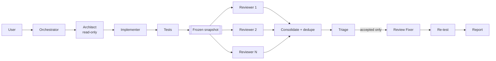

# dev-orchestra

[](https://github.com/istb16/dev-orchestra/actions/workflows/ci.yml)
[](https://github.com/istb16/dev-orchestra/releases)
[](LICENSE)

**English** | [日本語](README.ja.md)

**Stop letting AI review its own code.**

Claude builds. Codex challenges. dev-orchestra coordinates.

- **Independent reviews** — different models check the same diff, blind to each other.
- **No API keys** — it drives the CLI logins you already have.
- **One sentence to start** — "Add rate limiting to the login endpoint."

Works with Claude Code, Codex and Antigravity. Claude Code alone is enough to start.


## Quick start

```bash
claude plugin marketplace add istb16/dev-orchestra
claude plugin install dev-orchestra@dev-orchestra
```

Open a new Claude Code session and ask in plain words:

> Implement issue #12 with dev-orchestra.

On first use it asks which preset to save (`quality`, `standard` or `fast`)
and fits it to the CLIs you have installed. A typo fix goes straight to the
edit; a schema change gets the whole pipeline.

An introduction, in Japanese: [what dev-orchestra does, how it differs from
codex-plugin-cc, and why it helps even with Claude Code alone](https://tk3.biz/blog/2026-10-13-dev-orchestra-introduction/).

## Why

A model reviewing its own work shares the assumptions that produced the bug.
Different models, each reading the same diff without seeing the others,
disagree in useful ways — and that is where the real bugs are. Their findings
are deduplicated and triaged before anything is fixed, so the fixer gets a
short list, not every opinion.

## How it works

| Stage | Role in the config | What it does |
| --- | --- | --- |
| Direction | `orchestrator` | Decides which stages a request needs, digests bulk input, merges the results |
| Design | `architect` | Investigates and writes the plan, read-only; nothing is implemented until you approve it |
| Implementation | `implementer` | Writes the code and the tests from the plan |
| Review | reviewers | Two or more models read the same frozen diff, read-only, without seeing each other |
| Fix | `review_fixer` | Fixes only the findings the orchestrator accepted |



Every role can be any supported CLI and model family; `dev-orchestra config setup`
picks a lineup, and the [configuration](references/configuration.md) covers the rest.

## Requirements

- **Python 3.11+**, standard library only — `python3`, or `bin/dev-orchestra[.ps1]`, which finds it
- **git**
- **At least one CLI you are already logged in to**: [Claude Code](https://claude.com/claude-code) (`claude`),
  [Codex CLI](https://developers.openai.com/codex/cli) (`codex`), or the Antigravity CLI (`agy`),
  which takes only the implementer and the review fixer: it has no read-only mode
  ([providers](references/providers.md))

Linux, macOS and native Windows are CI-tested. Credentials are never requested,
stored or printed.

## Installation

Claude Code is in the [Quick start](#quick-start); inside a session it is
`/plugin marketplace add istb16/dev-orchestra`, then
`/plugin install dev-orchestra@dev-orchestra`.

**Codex:**

```bash
codex plugin marketplace add istb16/dev-orchestra
codex plugin add dev-orchestra@dev-orchestra
```

**Antigravity:** clone the repository, link it into the plugins folder, then
restart Antigravity.

```bash
git clone https://github.com/istb16/dev-orchestra.git
cd dev-orchestra
./install/install.sh --antigravity    # .\install\install.ps1 -Antigravity on Windows
```

A linked install loads whatever branch the checkout has, so look at an
untrusted branch with `--copy` or from a separate worktree. The other routes —
`agy plugin install`, a `plugins.json` entry, the installers from before the
plugin — are in [Installing from a skill checkout](references/workflow.md#installing-from-a-skill-checkout).

## Learn more

To drive a stage yourself, each command is in [workflow](references/workflow.md).
`dev-orchestra doctor` checks the CLIs, the configuration and the model families.

| Document | What it answers |
| --- | --- |
| [references/workflow.md](references/workflow.md) | What each stage does and the command behind it, the `.ai/` artifacts, example workflows, installing from a checkout |
| [references/configuration.md](references/configuration.md) | Presets, the wizard, every field, model families and tiers, the reply language, worked examples |
| [references/providers.md](references/providers.md) | Claude, Codex and agy, and adding your own CLI |
| [references/reviews.md](references/reviews.md) | The snapshot, withheld files, the fix-only second round, dedup, triage |
| [references/architecture.md](references/architecture.md) | How the pieces fit, and the security model |
| [references/limits.md](references/limits.md) | Stalls, timeouts, budgets, bulk input, what a run costs |
| [references/cli.md](references/cli.md) | Every command and flag, and troubleshooting |
| [references/json.md](references/json.md) | What each command prints with `--json` |

They are written for the orchestrating model as much as for you, which is why
they are in English; a Japanese translation of each, for people to read, is in
[docs/ja/references/](docs/ja/references/).

## Upgrading

```bash
claude plugin marketplace update dev-orchestra # Claude Code: refreshes the catalog only,
claude plugin update dev-orchestra             # so update the plugin too, then restart
codex plugin marketplace upgrade               # Codex: re-fetches the snapshot only,
codex plugin add dev-orchestra@dev-orchestra   # so add it again to install it
```

`claude plugin update` on its own answers "already at the latest version"
until the marketplace has been refreshed, and the refresh on its own leaves the
installed version as it was: run both.

A checkout install upgrades with `git pull` ([details](references/workflow.md#installing-from-a-skill-checkout)).
Antigravity: `git pull` in the checkout, then restart Antigravity. A copy
(`--copy`, `agy plugin install`, or `install.sh` under Git Bash, whose `ln -s`
copies) does not follow the checkout: run the same install command again after
`git pull`.
Configuration, artifacts and commands are compatible within a major version
([Compatibility](#compatibility)); `CHANGELOG.md` calls out anything that needs
action.

## Uninstalling

```bash
dev-orchestra hooks uninstall   # the reply-language hooks in your Claude Code settings, if any
claude plugin uninstall dev-orchestra
codex plugin remove dev-orchestra@dev-orchestra
dev-orchestra config reset --scope global --delete   # optional: your configuration
```

Configuration stays unless you remove it; delete `.ai/` in a project to drop
its artifacts. A checkout install has `install/uninstall.sh` (`.ps1` on Windows).
Antigravity: `./install/uninstall.sh --antigravity` (`-Antigravity` on Windows), then restart it.

## Compatibility

[Semantic versioning](https://semver.org/) from 1.0.0: a breaking change to
anything listed as covered is a major version, an addition is a minor version,
a fix is a patch. `CHANGELOG.md` ([Keep a Changelog](https://keepachangelog.com/))
calls out anything that needs action. Before 1.0.0 a minor release could still
break these, and says so under Changed in `CHANGELOG.md` with what to do — as
the release that narrowed `review.timeout_seconds` to reviewers did.

Covered:

- **The configuration schema** (`version: 1`): every documented key of
  `config.yaml` and `.dev-orchestra.yaml` and the values it accepts. A key may
  be added; a key is not removed, renamed or given a new meaning or type, and a
  file that validates keeps validating. A built-in default may change in a
  minor version and is listed under Changed with the old and the new value.
- **The `dev-orchestra` commands, their flags and their exit codes**
  ([cli](references/cli.md)). A command, a flag or an exit code may be added;
  none is removed or changes meaning. That includes the commands the skill
  records its own progress with: `state record`, `budget consume` and
  `progress record`.
- **The environment variables** `DEV_ORCHESTRA_CONFIG`, `DEV_ORCHESTRA_HOME`,
  `DEV_ORCHESTRA_WORKFLOW`, `DEV_ORCHESTRA_SESSION` and
  `DEV_ORCHESTRA_NO_USER_PROVIDERS`.
- **The `--json` output of every command** ([json](references/json.md) lists
  each command's keys and values): a key may be added; a key is not
  removed, renamed or given a new meaning or type. The documented values of a
  field that takes one of a list (`status`, `coverage`, `resume.reason`) are
  kept; the sentences inside `notes` and `warnings` are text and are not.
- **The `.ai/` artifact formats**: what dev-orchestra writes under
  `.ai/workflows/<id>/` and `.ai/current.json`, by the rule under "How the
  formats change" in [workflow](references/workflow.md#artifacts). A reviewer
  or architect report is the model's own text: its path is covered, its
  wording is not.
- **What the built-in adapters do** (claude, codex, agy, mock): the modes, the
  read-only enforcement, resuming, what a run records. The flags they pass to
  their CLIs are not.
- **What a user adapter relies on** ([providers](references/providers.md#interface-stability)):
  how one is loaded -- each `<name>.py` in `<config dir>/providers/` (in
  `$DEV_ORCHESTRA_HOME/providers/` when that is set) defining
  `build_provider(executable=None)` that returns a `Provider`, a name matching
  `^[a-z0-9][a-z0-9._-]*$` other than `base`, a built-in name refused, the
  first file in sorted order winning, a load failure reported by `doctor` and
  never fatal, and `DEV_ORCHESTRA_NO_USER_PROVIDERS` to skip them all. Also the
  import path `orchestrator.providers.base` and what the minimal example in
  [providers](references/providers.md#the-contract) takes from it:
  `Provider`, `ModelCandidate`, `ResolvedModel`, `ModelResolutionError` and
  `READ_ONLY_MODES`, called as the example calls them, and the members it
  defines or calls -- `name`, `display_name`, `executable`, `fallback_models`,
  `fallback_updated`, `option_keys` (the `options` keys a role may set on it,
  which `validate_options` holds the role's `options` to), `resolve_latest`,
  `build_command` and `option_args`.
- **What the reply-language hooks do** ([Reply-language hooks](references/architecture.md#reply-language-hooks)):
  dev-orchestra adds them to your Claude Code user settings only when you set
  `language.reply` or run `hooks install`. It changes only its own entries
  there and removes them with `hooks uninstall` or when `language.reply` is
  cleared. They act only with `language.reply` set, only in a session that
  used dev-orchestra, and never in a run it delegated. They block a reply at
  most once, and they fail open, printing nothing on any error. Not covered:
  the thresholds, what is stripped before judging, the reason wording, the
  relay script and its record, and the exact `command`/`args` of the entries.
- **The minimum Python version and the supported platforms**: raising or
  dropping one is a major version.

Not covered, and may change in a minor version:

- **The rest of the `Provider` base class** and the types around it
  ([providers](references/providers.md#interface-stability)): resuming, the
  live-check members, `around_launch` and `Launch`, `_capture`, the hooks that
  read a run's output, and model discovery. Such a change is listed in
  `CHANGELOG.md` in an entry that begins **User adapters**.
- **The human-readable output** of every command. Read `--json` where a
  program needs it.
- **`scripts/smoke_live.py` and the other maintenance scripts**
  (`stamp_translation.py`, `doc_contents.py`, `validate_skill.py`), their
  `--json`, and the `verified/` records they write in the config directory:
  per-machine records with a `schema` number, reported by `doctor` and remade
  by running the script again when the schema moves.
- **The modules under `scripts/orchestrator/`** as a Python API, apart from
  what a user adapter relies on above.
- **The wording of `skills/dev-orchestra/SKILL.md`** and the prompt templates.
  The commands they invoke are covered above.
- **The hidden `run --job-file` flag**, which only a detached job's worker
  passes.
- **`DEV_ORCHESTRA_MOCK_*`** and **`DEV_ORCHESTRA_TEST_*`**, which are test
  instruments.
- **`DEV_ORCHESTRA_DELEGATED`**, which the providers set on the processes they
  start so the hooks stay out of delegated runs: internal.
- **The internal files under `.ai/`**: `jobs/<id>.stop`, `.ai/agy-prompt-*`,
  the `.tmp-*.part` files a write goes through, the `*.lock` files, the
  temporary git index a snapshot uses, and `.ai/.gitignore`; and what
  `review-run.log` holds.
- **The text of `notes` and `warnings`** in `--json`, as above.

## Contributing

Issues and pull requests welcome — see `CONTRIBUTING.md`, which also says how
to report a security problem. Adapter fixes for a CLI that changed its flags or
model names are the most valuable contribution.

## Documentation language

The skill and `references/` are English, which AI models read best; the README
is in [English](README.md) and [日本語](README.ja.md). The translations in
`docs/ja/references/` are for people, the English stays authoritative, and the
tests fail when the English moves on without them (each names its sha256).

## License

MIT — see `LICENSE`.
